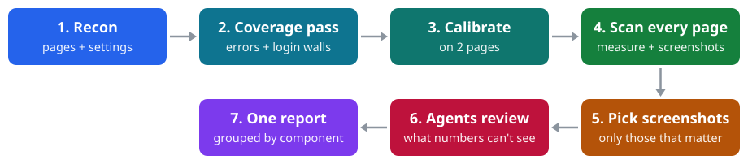

# ui-bug-hunt

[](https://github.com/amyyne01/ui-bug-hunt/actions/workflows/test.yml)
[](LICENSE)

A Claude Code skill that finds small visual bugs on every page of any website or web app, at phone, tablet and
desktop sizes. It writes a report. It does not change your code.

## How it works

<p align="center"></p>

## What it catches

| Measured by the browser | Seen by the review agents |
|---|---|
| Sideways scroll, controls past the screen edge | Awkward wrapping, misaligned rows and cards |
| Text cut off or squeezed into a sliver | Right-to-left order of numbers and dates |
| Controls or fixed bars drawn on each other | Contradictory states, mixed component styles |
| A button hidden under a fixed bottom bar | Untranslated words, placeholder content |
| A number split from its unit ("1,250" / "USD") | |
| Low contrast, broken images, tap targets under 44 px | |
| No hover feedback, hover that moves the neighbours | |
| An item a few px off its neighbours, an icon off its label | |
| One icon of a set at another size, controls of different heights in a row | |
| Same component with another colour or font, two almost-equal text colours | |
| A checkbox or switch cut off when clicked, animation included (`--toggle`) | |
| Layouts that break on live resize to 768 / 390 / 320 | |
| Error screens, login walls, raw i18n keys, failed requests | |

## Requirements

- [Claude Code](https://claude.com/claude-code)
- Node 18 or newer
- Google Chrome, or Playwright's Chromium
- A site URL. The source code is optional.

## Install

1. Add the skill. Pick one.

   **A. As a plugin**, inside Claude Code:

   ```
   /plugin marketplace add amyyne01/ui-bug-hunt
   /plugin install ui-bug-hunt@ui-bug-hunt
   ```

   **B. By hand**: copy the `skills/ui-bug-hunt` folder to `~/.claude/skills/` (all projects) or to
   `<project>/.claude/skills/` (one project).

2. Install Playwright once, in the skill's `scripts` folder:

   | Install | The `scripts` folder |
   |---|---|
   | A. plugin | `~/.claude/plugins/cache/ui-bug-hunt/ui-bug-hunt/<version>/skills/ui-bug-hunt/scripts` |
   | B. by hand | `~/.claude/skills/ui-bug-hunt/scripts` |

   ```
   npm install
   ```

   Or ask Claude: "run npm install for the ui-bug-hunt skill".

3. Only if Google Chrome is not installed, in the same folder:

   ```
   npx playwright install chromium               # macOS, Windows
   npx playwright install --with-deps chromium   # Linux
   ```

4. Check it. Restart Claude Code: the skill `ui-bug-hunt` is listed. Or run a one-page scan (`routes.txt` is a
   file with the single line `/`):

   ```
   node <scripts>/scan.mjs --base https://example.com --routes routes.txt --matrix "-:d" --out ui-hunt/test
   ```

   It ends with `all page loads done`.

## Use

Add `ui-hunt/` to your `.gitignore` first: screenshots and a saved session must not be committed. Then type in
Claude Code:

```
scan all the UI of https://my-site.com for visual bugs
```

Claude runs the seven steps above and asks before anything that needs you (signing in, for example). The scan
runs in 10-minute chunks and resumes by itself. The report lands in `ui-hunt/report.md`, with findings ranked
high / medium / low, each with its route, screen size, screenshot and likely source file, then a list of what
was not covered. Nothing is fixed until you say so.

## Good to know

- **Signed-in pages**: save a session once with
  `npx playwright codegen --channel chrome --save-storage=ui-hunt/state.json <login url>`, then pass
  `--storage ui-hunt/state.json`.
- **Production with real data**: `--read-only <regex>` aborts every POST/PUT/PATCH/DELETE whose URL matches.
  Match the API host or path only, never the site's own pages.
- **`--crawl` follows links by itself**: use it on public pages or a test account, never a signed-in production
  admin. The scanner refuses to crawl with `--storage` unless you add `--crawl-signed-in`.
- **The scanner never clicks buttons or links, and never submits forms.** It loads, hovers, resizes and measures.
- **`--toggle` is the one pass that clicks**: each checkbox and switch is clicked, watched frame by frame for
  anything cut off, then clicked again to put it back. It is off unless asked for, and refused with `--storage`
  unless you add `--toggle-signed-in` (a test account or a mocked API only).
- **Cost**: the browser pass is cheap. Reading screenshots is the expensive part, about 100-180k tokens per
  review agent, so `pick.mjs` keeps about 1.2 images per page instead of 3-4.
- **Windows Git Bash**: run `export MSYS_NO_PATHCONV=1` first, or arguments like `/pricing` turn into Windows paths.
- **A mistyped flag stops the run.** `node <scripts>/scan.mjs --help` lists every flag.

## Run the scripts without Claude

From your project folder. Give the pages with one of `--routes <file>`, `--sitemap <url>`, `--crawl <n>` or
`--discover <next.js folder>`.

```
node <scripts>/scan.mjs --base https://example.com --crawl 150 --matrix "-:d,m,x" --hover --resize --shots --budget 600 --out ui-hunt/scan
node <scripts>/pick.mjs --shots ui-hunt/scan/shots --out ui-hunt/review ui-hunt/scan
node <scripts>/report.mjs ui-hunt/report.md ui-hunt/scan
```

`--matrix "-:d,m,x"` means no locale in the URLs, at desktop, phone 390 and phone 320. With locales:
`--matrix "en:d,m,x;ar:m" --locale-mode prefix`. `--budget 600` ends a chunk after 10 minutes; the same command
resumes it.

## Test

```
node test/selftest.mjs
```

It serves pages with one seeded bug each and checks that every bug is caught and the clean pages stay clean.

## License

[MIT](LICENSE), by amyyne01.
